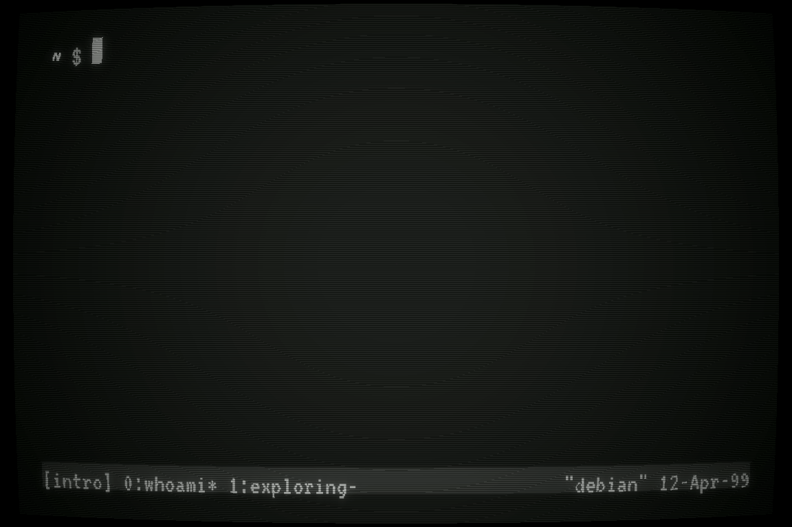

# Artem Dragunov



<details>
<summary>Behind the scenes</summary>
<br>

It's a real program, not a screen recording of me typing:

```sh
make run
```

To regenerate `demo.gif` after editing `main.c`, install GCC, Make, the ncurses development headers, [asciinema](https://asciinema.org), [agg](https://github.com/asciinema/agg), jq, and FFmpeg, then run:

```sh
make demo
```

This rebuilds the program, records one loop using `./intro --duration`, renders it with the bundled [VT323](fonts) font, and applies the CRT effect. Recording also requires GNU `timeout` and a UTF-8 locale. Run it from a terminal and leave the keyboard untouched until recording finishes.

Use `make -B demo` to force a fresh recording even when the files are up to date. If `agg` isn't on your `PATH`, use `make demo AGG="$HOME/.cargo/bin/agg"`. Commit the updated `demo.gif` to refresh the image on GitHub.

</details>
